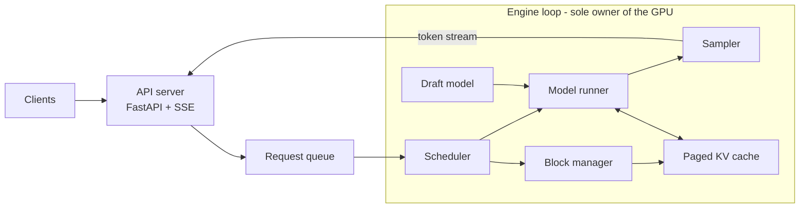

# inference-engine

# inference-engine


A single-GPU LLM inference engine built from scratch in PyTorch, with continuous batching, a paged KV cache and speculative decoding, benchmarked against Hugging Face Transformers and vLLM.

> **Status: in progress.** The engine is being built in stages (M0 to M5 below). Every stage is tested for correctness against Hugging Face and benchmarked before the next one starts. Results will appear here as each milestone lands.

## Why this project

Serving LLMs efficiently is mostly a systems problem. Decoding one token at a time is limited by memory bandwidth rather than compute, so throughput depends on keeping the GPU busy with large batches without wasting KV cache memory. This project implements the techniques that production engines like vLLM use to do that, from first principles, and measures what each one contributes.

Everything below the tokenizer and weight files is written from scratch: the transformer forward pass, the KV cache and block manager, the scheduler, the sampler, speculative decoding and the streaming server.

## Results

_Coming soon._ Planned comparisons, all on the same GPU, model, prompts and settings:

| System | Output tokens/s | p95 TTFT | p95 TPOT |
| --- | --- | --- | --- |
| Hugging Face Transformers (static batching) | – | – | – |
| This engine | – | – | – |
| vLLM (reference ceiling) | – | – | – |

An ablation chart will show the throughput gained at each milestone.

## Milestones

- [ ] **M0:** Benchmark harness and Hugging Face baseline
- [ ] **M1:** Llama-style transformer written from scratch, matching Hugging Face outputs
- [ ] **M2:** KV cache with separate prefill and decode
- [ ] **M3:** Continuous batching behind an OpenAI-compatible streaming API
- [ ] **M4:** Paged KV cache with block tables and preemption
- [ ] **M5:** Speculative decoding (greedy and exact rejection sampling)
- [ ] **M6:** Profiling-driven optimizations (CUDA graphs, prefix caching or chunked prefill)

## Architecture



The HTTP layer only enqueues requests and streams tokens back. A single engine loop runs in its own thread and owns the GPU: each step, the scheduler builds a batch from running and waiting requests, the model runner does one forward pass over the paged KV cache, and the sampler picks the next token for every sequence.

## Getting started

Requirements: Linux (or WSL2 on Windows), an NVIDIA GPU, Python 3.11+.

```bash
git clone git@github.com:<your-username>/inference-engine.git
cd inference-engine
python3 -m venv .venv && source .venv/bin/activate
pip install torch --index-url https://download.pytorch.org/whl/cu126
pip install -r requirements.txt
```

Run the tests:

```bash
pytest              # all tests (needs a CUDA GPU)
pytest -m "not gpu" # CPU-only tests, as run in CI
```

Server and benchmark instructions will be added with M3.

## Repository layout

```
engine/      model, KV cache, attention, scheduler, sampler, engine loop
server/      FastAPI app with streaming and metrics
bench/       load generator, workloads, baselines, reports
tests/       correctness and unit tests
results/     raw benchmark results with environment info
docs/        design notes and lab notebook
```

## References

- Yu et al., *Orca: A Distributed Serving System for Transformer-Based Generative Models*, OSDI 2022
- Kwon et al., *Efficient Memory Management for Large Language Model Serving with PagedAttention*, SOSP 2023
- Leviathan et al., *Fast Inference from Transformers via Speculative Decoding*, 2023
- Chen et al., *Accelerating Large Language Model Decoding with Speculative Sampling*, 2023

## License

MIT