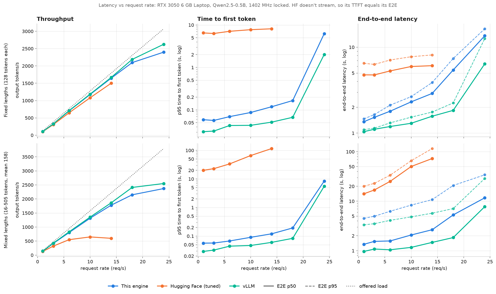
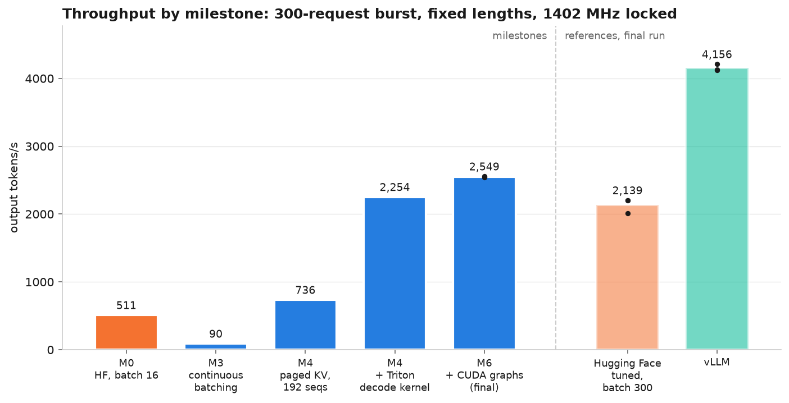
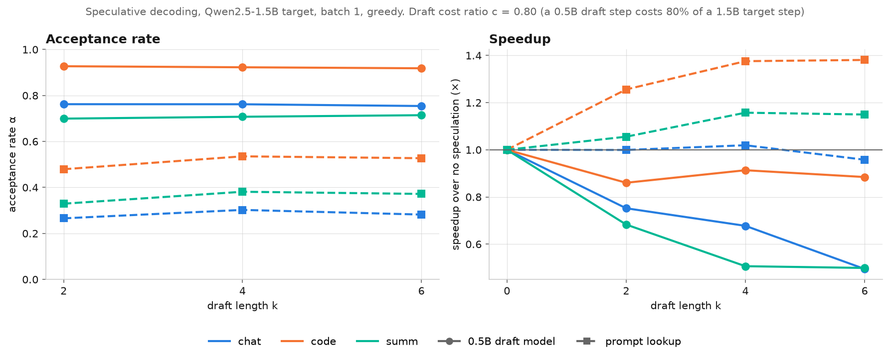
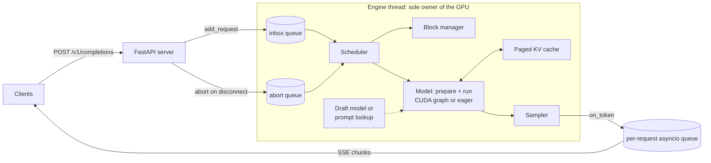

# inference-engine

A single-GPU LLM inference engine written from scratch in PyTorch and Triton, with continuous batching, a paged KV cache, a Triton paged-attention kernel, CUDA graphs and speculative decoding, behind an OpenAI-compatible streaming API.

## Results

**Serving mixed-length requests at 14 req/s, the engine delivers 3.0× the throughput of a tuned Hugging Face Transformers server at 27× lower median latency. vLLM, the reference ceiling, has 1.6× the engine's peak throughput and 1.8× lower median latency at that rate.**

All three systems served Qwen2.5-0.5B-Instruct (bf16) on the same RTX 3050 6 GB Laptop GPU, with its clock locked at 1402 MHz. They got the same 200-token prompts and the same output lengths. In the mixed workload each request's `max_tokens` is drawn from 16 to 505 tokens (mean 158) with a fixed seed. Each figure is the mean of 3 runs from one session; there were 0 errors in 132 runs.

| Workload | Metric | This engine | Hugging Face (tuned) | vLLM 0.34 |
|---|---|---|---|---|
| Mixed lengths, 14 req/s | output tokens/s | **1,777** | 598 | 1,861 |
| | E2E latency p50 / p95 | **2.65 / 10.8 s** | 72.8 / 116 s | 1.47 / 5.7 s |
| | TTFT p50 / TPOT p50 | 0.07 s / 25.6 ms | 72.8 s / n/a* | 0.05 s / 13.5 ms |
| Mixed lengths, 24 req/s (past saturation) | output tokens/s | 2,370 | — | 2,549 |
| Burst of 300, mixed lengths | output tokens/s | 2,245 | 859 | 3,570 |
| Burst of 300, fixed 128 tokens | output tokens/s | 2,549 | 2,139 | 4,156 |

\* The Hugging Face server returns each response whole, so its time to first token equals its end-to-end latency.

- **Mixed lengths are where continuous batching pays.** A static batch runs until its longest request finishes, so short requests hold their slots idle and new arrivals queue behind the whole batch. Hugging Face saturates near 4 req/s on this workload. The engine admits a new request into a slot the moment one frees up, and keeps up with the offered load to about 14 req/s.
- **The fixed-length burst is static batching's best case,** and there the engine leads by only 19%. 300 identical requests that arrive together and all stop at 128 tokens form one full batch with no padding and no early finishers. Hugging Face's batch cap was tuned to 300 by a sweep; at its old cap of 16, the engine looked 5× faster.
- **vLLM stays well ahead.** Its peak throughput, measured on the bursts, is 1.6× the engine's (the engine reaches 61–63% of it). Up to 14 req/s both systems keep up with the offered load, so their throughput there is similar, but vLLM's tokens come 1.3–1.9× faster and its median request finishes 1.3–1.8× sooner. [docs/design.md](docs/design.md#6-limitations-and-the-gap-to-vllm) explains why.



**Where the throughput came from**, measured on the same 300-request burst at each milestone:



Continuous batching (M3) was slower than the baseline at first, because its attention looped over sequences in Python and every step was bound by kernel launches. The paged KV cache (M4) let about 6× more sequences fit in memory. The Triton paged decode kernel turned that concurrency into throughput (2.8×), and CUDA graphs removed the remaining launch overhead.

**Speculative decoding** (M5, Qwen2.5-1.5B target): prompt lookup pays, with up to 1.38× on code. A 0.5B draft model loses at every draft length, because on this GPU a draft step costs 80% of a target step (c = 0.80).



## How it works



**In 60 seconds.** The HTTP server never touches the GPU. It validates each request, puts it on a queue, and streams tokens back as server-sent events. One engine thread owns the GPU and runs a loop. At every step the scheduler picks which sequences run: all running decodes first, one token each, then as many waiting prompts as fit in a 2,048-token budget. The model then runs one forward pass over that mixed batch, and the sampler picks each sequence's next token. Finished sequences leave at once and waiting ones take their place, which is continuous batching. Each sequence's keys and values live in 16-token blocks of a shared pool, found through a block table, so memory grows only as a sequence grows. When the pool runs out, the newest sequence is preempted and later recomputed. Decode attention is a Triton kernel that reads the paged blocks directly. Decode-only steps replay a captured CUDA graph instead of launching hundreds of kernels. Optionally, prompt lookup or a draft model proposes several tokens, and the target model checks them all in one pass, accepting the matching prefix (greedy) or applying the rejection rule that keeps sampling exact.

Everything below the tokenizer and the weight files is written from scratch: the transformer forward pass, the paged KV cache and block manager, the attention kernel, the scheduler, the sampler, speculative decoding and the streaming server. Every stage is tested against Hugging Face outputs. [docs/design.md](docs/design.md) covers each design decision and its alternative, what didn't work, and the limitations. Raw results for every number, with the commit and GPU state they were measured at, are in [results/](results/).

## Reproduce

```bash
bash bench/run_all.sh                         # full suite, ~2.7 h -> results/final/
python -m bench.report --final results/final  # table + the three figures in docs/figures/
```

`run_all.sh` starts each server in turn (this engine, Hugging Face, vLLM), soaks it, and runs every rate and the burst on both workloads, 3 times each. It refuses to start unless the GPU clock reads `LOCK_MHZ` (default 1402), and on a rerun it skips results that already exist. `QUICK=1 bash bench/run_all.sh` does a 10-minute smoke run. vLLM is expected in its own virtual environment at `~/venvs/vllm` (override with `VLLM=`), because it pins its own PyTorch:

```bash
python3 -m venv ~/venvs/vllm && ~/venvs/vllm/bin/pip install vllm && ~/venvs/vllm/bin/vllm download-kernels
```

## Getting started

Requirements: Linux (or WSL2 on Windows), an NVIDIA GPU, Python 3.11+.

```bash
git clone https://github.com/Justin67o/inference-engine.git
cd inference-engine
python3 -m venv .venv && source .venv/bin/activate
pip install torch --index-url https://download.pytorch.org/whl/cu126
pip install -r requirements.txt
```

Serve the model and send a request:

```bash
uvicorn server.app:app --port 8000      # settings from ENGINE_* env vars, e.g. ENGINE_MAX_NUM_SEQS=256
curl -N localhost:8000/v1/completions -H 'Content-Type: application/json' \
  -d '{"prompt": "Explain why the sky is blue.", "max_tokens": 64, "stream": true}'
```

Run the tests:

```bash
pytest              # all tests (needs a CUDA GPU)
pytest -m "not gpu" # CPU-only tests, as run in CI
```

## Milestones

- [x] **M0:** Benchmark harness and Hugging Face baseline
- [x] **M1:** Llama-style transformer written from scratch, matching Hugging Face outputs
- [x] **M2:** KV cache with separate prefill and decode
- [x] **M3:** Continuous batching behind an OpenAI-compatible streaming API
- [x] **M4:** Paged KV cache with block tables, preemption and a Triton paged decode kernel
- [x] **M5:** Speculative decoding (prompt lookup and a draft model; greedy and exact rejection sampling)
- [x] **M6:** CUDA graphs for decode steps, chosen by profiling

## Repository layout

```
engine/      model, paged KV cache, attention kernels, scheduler, sampler, CUDA graphs, engine loop
server/      FastAPI app with SSE streaming and Prometheus metrics
bench/       load generator, workloads, baselines, run_all.sh, reports
tests/       correctness and unit tests
results/     raw benchmark results with environment info and server logs
docs/        design document and figures
```

## References

- Yu et al., *Orca: A Distributed Serving System for Transformer-Based Generative Models*, OSDI 2022
- Kwon et al., *Efficient Memory Management for Large Language Model Serving with PagedAttention*, SOSP 2023
- Leviathan et al., *Fast Inference from Transformers via Speculative Decoding*, 2023
- Chen et al., *Accelerating Large Language Model Decoding with Speculative Sampling*, 2023

## License

MIT
