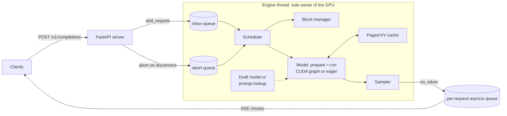

# Design

This document explains how the engine is built, the main decisions and the alternatives to each, what did not work, and where the engine stands against Hugging Face Transformers and vLLM. Benchmark numbers come from the result files in [results/](../results/), each of which records its commit and GPU state; the rest come from my lab notes, cited by commit hash where one applies. Unless a number says otherwise, it was measured on an RTX 3050 6 GB Laptop GPU under WSL2 with the clock locked at 1402 MHz, serving Qwen2.5-0.5B-Instruct in bf16.

## 1. Architecture

**One thread owns the GPU.** The server's `lifespan` builds the engine and starts `run_forever` on a daemon thread. Only that thread touches the scheduler, the block manager, the KV cache and the model. The HTTP side talks to it through two queues: an inbox for new requests and an abort queue for clients that disconnect. The engine loop never has to lock anything, and each forward pass sees a consistent view of every sequence.

**Errors surface on the caller's thread.** `add_request` runs the scheduler's `check` (prompt plus `max_tokens` must fit the model length, the token budget and the KV pool) before enqueueing. The server calls it before it creates the streaming response, so a bad request gets a 400 and never a broken 200 stream. If the engine thread dies, every pending request ends with `finish_reason="error"`, `/health` returns 503 and new requests get a 503 too (`b3ebf21`). Before that fix, a dead engine left the server up and clients waiting forever.

**One step** (`Engine.step`):
1. Drain the inbox, then the aborts.
2. The scheduler picks this step's decodes and prefills under the token budget (§2.3).
3. Build one flat batch: the whole prompt for each prefill (prompt plus output after a preemption) and the newest token for each decode.
4. Run the model once. Decode-only steps replay a CUDA graph; any step with a prefill or drafts runs eager (§2.6).
5. Sample, append each token, and call `on_token(token, done)`. The `.tolist()` here is the step's only CPU–GPU sync.

**Streaming.** `on_token` runs on the engine thread and hands each token to the request's `asyncio.Queue` with `call_soon_threadsafe`. The response generator passes tokens through an incremental detokenizer (so a multi-byte character split across tokens isn't sent half-finished) and a stop-string filter (matching on text, not ids), and sends OpenAI-style `text_completion` chunks over SSE. When a client disconnects, Starlette cancels the generator and a `finally` block aborts the request, which frees its slot and KV blocks. `/metrics` exports Prometheus counters (free blocks, preemptions, speculative acceptance), read at scrape time so the engine never pays for them.

## 2. Decisions and alternatives

### 2.1 Paged KV cache instead of contiguous preallocation

In M2/M3 each sequence reserved a contiguous cache of `max_model_len` = 2048 tokens. At 12 KiB per token for the 0.5B model that is 24 MiB per sequence. A typical request (200-token prompt, 128 output tokens) used 13% of what it reserved, so 32 sequences filled the 768 MiB pool.

M4 replaced this with a paged cache, as in PagedAttention. The cache is a pool of fixed-size blocks; each sequence has a block table mapping its logical positions to physical blocks; blocks are allocated as the sequence grows and freed when it finishes. Measured on the burst, 97% of reserved slots then held real tokens, and the same 4096-block pool held about 195 sequences instead of 32. The pool is now sized from free memory after weights, activations and CUDA graph buffers (`num_blocks_for`).

**Block size 16.** A block holds 16 tokens, 192 KiB for this model. The tradeoff is internal fragmentation against bookkeeping. A sequence wastes at most 15 slots in its last block (under 180 KiB). Smaller blocks would waste less but double the block-table width and the number of gathers per decode. Larger blocks would waste more per sequence and make prefix sharing coarser. 16 is also vLLM's default, and it is a natural tile for the Triton kernel, which walks one block per inner iteration. The allocator's property tests run at 8, 16 and 32. I did not benchmark other sizes: at a 2048-token maximum length, fragmentation is a few percent either way and was never the bottleneck.

### 2.2 Preemption by recompute, not swap

When decode needs a block and none is free, the scheduler preempts. `preempt(r)` frees all of the victim's blocks, keeps its generated tokens, and puts it at the front of the waiting queue. When readmitted, it re-prefills prompt plus output in one step. The victim is the newest running sequence, so the oldest requests keep making progress, and the oldest victim is readmitted first. No new request is admitted in a step that preempted.

The alternative, swapping blocks to CPU memory and back, keeps the work already done but costs PCIe transfers both ways. It also needs pinned host memory and a second allocator, and under WSL2 host memory is itself limited (10 GB for the whole VM). Recompute costs one prefill, and prefill is compute-bound and fast for a 0.5B model at these lengths. It is also simple: preemption is "free the blocks, move the request back", and the forced-preemption tests show outputs identical to an unpreempted run, both greedy and seeded. That reasoning, not a measurement, decided it; I never built swap to compare.

One consequence: a preempted request must re-prefill everything in a single step, so `check` rejects requests whose prompt plus `max_tokens` minus one exceeds `max_num_batched_tokens`.

**Admission watermark.** New requests are admitted only if they leave 10% of blocks free (`watermark = 0.1`), so running sequences have room to grow without immediately preempting each other. This is higher than vLLM's 1%. I kept the larger margin because preemption by recompute is expensive at high concurrency. I did not sweep it.

### 2.3 Scheduling: FCFS, decodes first, one shared step

Each step has a budget of `max_num_batched_tokens` = 2048 tokens. Running decodes go first, at one token each, so a burst of new prompts can never stall sequences already streaming. Prefills take what's left, in arrival order. Admission stops at the first request that doesn't fit: skipping ahead to smaller requests would raise throughput but could starve long prompts. Prefills and decodes share one forward pass, so a step is never only prefill or only decode.

There is no chunked prefill: a prompt is prefilled in one step or not at all. With the 2048 budget and 200-token prompts this never mattered. A sweep of the budget (256 / 1024 / 4096) at M3 was inconclusive, because run-to-run noise at that milestone (TTFT p95 from 2.9 to 32 s across three identical runs) swamped the effect.

**Concurrency cap.** `max_num_seqs` bounds the running batch. On the burst, 192 was the best setting: 736 tok/s with PyTorch attention and 2,033 with the Triton kernel. 256 preempted 55 times and ran about 5% slower (701 and 1,926). For steady traffic 256 is better: at rate 6 it cut TTFT p95 from 3.99 s (32 seqs) to 0.18 s, because arrivals never wait for a slot. The final benchmarks use 256 for rate runs and 192 for the burst.

### 2.4 Attention: SDPA for prefill, a Triton kernel for paged decode

The M2/M3 engine looped over sequences in Python for attention: about 15 kernel launches per sequence per layer, roughly 8,600 launches per step at batch 32. That made M3 slower than the Hugging Face baseline (§3). M4 rewrote attention in stages:

1. **Prefill uses PyTorch SDPA** with a causal mask. This is only correct when a segment's queries and keys both start at position 0, which holds because there is no chunked prefill.
2. **Batched decode with one paged gather per layer**, then grouping query heads by KV head (GQA) instead of `repeat_interleave`: 5.4× faster per layer.
3. **A Triton paged decode kernel** (`934e517`, used from `d957ddd`). One program per (sequence, KV head) walks the sequence's block table one 16-token block at a time with an online softmax, so no gathered copy of the cache is ever built. The query heads that share a KV head are padded to 16 rows so the kernel can use `tl.dot`. That took a layer from 1.34 ms (an elementwise first draft) to 0.20 ms. It uses `input_precision="ieee"`, because TF32 was off by 2–4e-3. Tile size and `num_warps` made no measurable difference.

The burst went from 736 to 2,033 tok/s (2.8×), and TPOT p50 at rate 6 dropped from 60–70 ms to 33 ms. On machines without Triton (CPU CI) the engine falls back to the PyTorch path, which the Triton kernel is tested against.

### 2.5 Speculative decoding: two proposers, one verify path

M5 added speculative decoding with two proposers behind the same verify step:

- **Prompt lookup** finds the longest recent n-gram (up to 3 tokens) of the output that also appears earlier in the context and proposes what followed it. It costs no model.
- **A draft model** (Qwen2.5-0.5B drafting for Qwen2.5-1.5B) proposes k tokens autoregressively. Its KV cache uses the same block ids as the target's, so one block manager serves both and the two can never disagree about what's allocated.

The target verifies all k drafts in one forward pass. Greedy requests accept the longest matching prefix. Sampled requests use the rejection rule from Leviathan et al. and Chen et al., which keeps the output distribution exactly the target's; a chi-squared test checks this (p = 0.725, and p = 0.000 with verify sabotaged to always accept). Rejected drafts need no KV rollback (their slots are overwritten next step), and blocks past the accepted length are trimmed. When blocks run short, drafting drops to k = 0 before anyone is preempted.

**Result: prompt lookup pays, the draft model doesn't.** At batch 1 on the 1.5B target, lookup at k = 4 gave 1.38× on code and 1.16× on summarization, and broke even on chat. The draft model lost at every k and batch size (0.49–0.91×), despite accepting 71–92% of its drafts. The reason is its cost: a 0.5B draft step takes 80% of a 1.5B target step (c = 0.80), because on this GPU step time follows layer count and launch overhead (24 layers vs 28), not parameters. k draft steps at 0.8 each can't be paid back by about three accepted tokens per pass. Measured tokens per pass matched the formula (1 − α^(k+1)) / (1 − α) within 4%, so the acceptance accounting is right; the cost side is what fails. See [acceptance_vs_k.png](figures/acceptance_vs_k.png).

Speculation also gets worse with batch size here (draft model at k = 4: 0.66× at batch 1, 0.27× at batch 16). The verify path loops over sequences in Python, so its cost grows with the batch. It's the same launch-overhead problem M4 fixed for plain decode.

### 2.6 CUDA graphs for decode-only steps

Profiling the M5 engine at steady-state decode showed the step was launch-bound: at batch 32 the GPU ran 12.6 ms of kernels inside a 24 ms step, and the rest was Python and launch gaps. Of the stretch features (CUDA graphs, prefix caching, chunked prefill, int8 weights), only CUDA graphs target launch overhead, so that's what M6 built (`d14a3a9`).

The engine captures one graph per batch-size bucket (1, 2, 4, … up to `max_num_seqs`), largest first into one shared memory pool. Each step copies token ids, positions, write slots, lengths and block tables into static buffers, then replays the smallest bucket that holds the batch. Padding rows read and write a dummy KV block that the block manager never hands out. Block tables are a fixed 128 blocks wide, because the Triton kernel takes their stride as a Python int. Steps with a prefill or drafts run eager. The graphs' logits buffer is reserved before the KV pool is sized (`979631c`), so capture can't run the pool out of memory.

Engine-only, decode steps got 2.1× faster at batch 32 (24 → 11.4 ms, now at the kernel-time floor) and 1.24× at batch 192, where kernels were already longer than their launches. Through the server, TPOT p50 at rate 6 fell from 33 to 13 ms and E2E p50 from 4.22 to 1.73 s.

### 2.7 Sampler

Temperature, top-k and top-p are per row, all from one shared sort, and seeded requests each get a private `torch.Generator`. Sorting 151,936 logits per row is the expensive part (12.3 ms at batch 32, a quarter of a 45 ms step at the time), so the sampler takes fast paths: all-greedy rows skip sampling entirely (0.1 ms), and temperature-only rows skip the sort (2.6 ms). The settings stay as Python lists so these checks never sync with the GPU.

### 2.8 Benchmark methodology

- **Locked clocks.** Laptop GPU boost made run-to-run spreads of 8–40% at M0. All benchmark numbers are at a locked 1402 MHz, with a soak of 500 requests at rate 3 after each server start so the GPU is at a steady temperature.
- **`ignore_eos`** on every request, so every system generates exactly the tokens asked for.
- **A mixed-length workload.** Identical prompts with exactly 128 output tokens each are static batching's best case: nobody finishes early, so no slot sits idle. The mixed workload draws each request's `max_tokens` log-uniformly from 16 to 512 with a fixed seed (`bench/prompts/mixed_200.jsonl`, mean 158). Every system gets the same lengths, and throughput counts the tokens each request actually asked for (`2fdfd6f`).
- **A tuned Hugging Face baseline.** The M0 baseline capped HF's batch at 16, and that cap alone made the engine look 3.9× faster on the burst. A sweep of `HF_MAX_BATCH` (16–300) picked 300 (`b60ae44`). HF uses a 20 ms batching window for rate runs and 0.5 s for the burst.
- **Repeated runs.** The final suite runs each configuration 3 times and reports means. Throughput agrees within a few percent; latency percentiles on this laptop don't reach 5% agreement (host CPU speed alone moved them 10–20% with the GPU locked), so small latency differences are noise.

## 3. What did not work

- **M3 was slower than the baseline it replaced.** Continuous batching served about 80 tok/s at every rate, while the HF baseline did 102 / 284 / 483 at rates 1 / 3 / 6. At batch 32 a step took 304 ms, and only 48 ms with attention stubbed out; the GPU was 15–20% busy. The per-sequence Python attention loop made every step launch-bound. Continuous batching only pays once the step itself is batched, which M4 did.
- **Compiling the HF baseline** (static cache plus `torch.compile(mode="reduce-overhead")`) deadlocked the server after one batch. Transformers 5.20 already compiles the decode step for a static cache, so it was compiled twice, from `asyncio.to_thread`'s worker. Even run directly, it was slower at batch 64 (1,259 vs 1,924 tok/s), skipped CUDA graphs because of mutated inputs, and recompiled for 24–38 s at every new batch size. Dropped.
- **The 0.5B draft model** never paid for itself on this GPU (§2.5).
- **Latency agreement within 5%** across repeated runs was never reached (§2.8). Throughput is the reliable number.

**The hardest bugs:**
- **The 256-sequence burst crashed with `CUDA error: unknown error`.** Replaying in-process with a 5 GB cap showed allocated memory peaking at 2.3 GB while *reserved* memory grew about 250 MB per step. Under WSL2, `cudaMalloc` doesn't fail at 6 GB because Windows lends system RAM, so PyTorch's caching allocator never flushed and the driver eventually failed. `expandable_segments:True` keeps reserved memory flat (2356 MiB), and it's now the engine default.
- **NaN tokens from padded slots.** CPU decode attention gathered into `torch.empty` buffers; masked weights were 0, but 0 × NaN is NaN, and argmax over NaN picked token 0. It only failed when the whole test file ran, after GPU tests had left garbage in reused host memory. Fixed by zeroing V at padded positions (`80fdc3c`).
- **A `return` indented inside a loop in greedy acceptance.** Every engine test still passed, because random-weight draft models almost never get a draft accepted. Only the unit tests for `verify` caught it, which is why every new piece gets its own unit test with a planted bug to prove the test can fail.
- **bf16 parity failures that weren't bugs.** Qwen's `generation_config` applies `repetition_penalty=1.1` even when greedy (181 false mismatches); a 1-row vs T-row `lm_head` matmul differs by 3.7e-3; and SDPA prefill against an eager HF reference diverged on 86 of 200 near-tied prompts. The parity tests now use plain greedy, an SDPA reference, and fail only when the top-2 logit gap is at least 0.5.

## 4. Correctness

- **Parity with Hugging Face** (`tests/test_parity.py`): 50 prompts with fp32 logits within 1e-3, and 200 prompts (10 categories × 20) greedy for 32 tokens in bf16, where near-ties may be at most 5%. `tools/compare_layers.py` compares 75 hook points layer by layer; bf16 is bit-identical to HF eager.
- **Engine invariants:** outputs don't depend on arrival order; forced preemption with a tiny pool gives identical outputs (greedy and seeded); no block leaks after any kind of finish, including a 10,000-request soak with a random model; Hypothesis property tests on the allocator at block sizes 8, 16 and 32; CUDA graph replay is `torch.equal` to eager.
- **Kernels:** paged decode matches reference attention (atol 1e-4); Triton matches PyTorch (1e-3 fp32, 2e-2 bf16).
- **Speculative decoding:** greedy speculation is token-identical to plain greedy; sampled speculation passes the chi-squared test above.
- **CI** runs `ruff` and `pytest -m "not gpu"` on CPU-only PyTorch (163 tests). The GPU suite runs locally (431 tests at M5).

## 5. Final results

One locked session (`bench/run_all.sh`, Nov 26, `15a34d3`): 132 runs, 3 per configuration, 0 errors, 0 engine preemptions. Means below; the full table comes from `python -m bench.report --final results/final`.

| Workload | Engine | Tuned HF | vLLM |
|---|---|---|---|
| Mixed lengths, 14 req/s: tok/s | **1,777** | 598 | 1,861 |
| Mixed, 14 req/s: E2E p50 / p95 | **2.65 / 10.8 s** | 72.8 / 116 s | 1.47 / 5.7 s |
| Mixed, 14 req/s: TTFT p50 / TPOT p50 | 0.07 s / 25.6 ms | 72.8 s / n/a | 0.05 s / 13.5 ms |
| Mixed, 24 req/s (past saturation): tok/s | 2,370 | — | 2,549 |
| Mixed burst (300 requests): tok/s | 2,245 | 859 | 3,570 |
| Fixed burst (300 requests): tok/s | 2,549 | 2,139 | 4,156 |
| Fixed, 6 req/s: E2E p50 | 1.80 s | 5.30 s | 1.19 s |

**Against Hugging Face, mixed lengths are where continuous batching pays.** At 14 req/s the engine delivers 3.0× HF's throughput at 27× lower median latency. HF saturates near 4 req/s on this workload: each batch runs until its longest request finishes, so a 16-token request holds its row for up to 505 steps, and new arrivals queue behind the whole batch. Its median latency climbs from 14 s at 1 req/s to 73 s at 14. The engine admits new requests into the slots finished ones free, so it tracks the offered load up to about 14 req/s.

**On the fixed-length burst, the gap is only 19%.** Identical prompts, identical output lengths and simultaneous arrival are static batching's best case: HF runs all 300 requests as one full batch, with no padding and no early finishers. Both systems then run the same cuBLAS matrix multiplies at a large batch. The engine's 19% comes from CUDA graphs; its real advantage here is latency (TTFT p50 3.0 s vs 16.1 s). In one of HF's three burst runs, the first 21 requests filled the 0.5 s batching window early and the burst split into two batches (21 + 291).

**Saturation.** The engine follows the offered load to about 14 req/s on both workloads. Between 18 and 24 req/s its TTFT p95 jumps from 0.17 s to 6.3 s (fixed) and 0.19 s to 8.4 s (mixed), as arrivals start waiting for the running batch. Its capacity is about 2,400 tok/s at rate 24 and 2,550 on the fixed burst.

The ablation ([ablation.png](figures/ablation.png)) shows where the burst throughput came from: 511 tok/s for the M0 baseline (HF at batch 16), 90 for M3, 736 for the paged cache at 192 sequences, 2,254 with the Triton decode kernel, and 2,549 with CUDA graphs. The paged cache let more sequences run at once, but only batched attention turned that concurrency into throughput.

## 6. Limitations and the gap to vLLM

**How far from vLLM.** vLLM 0.34.0 ran with the same model, prompts, lengths and clock, at `--gpu-memory-utilization 0.8`, with its FlashInfer kernels installed.

- **Peak throughput: the engine reaches 61–63% of vLLM's.** On the bursts, where both systems run flat out, vLLM does 4,156 vs 2,549 tok/s with fixed lengths and 3,570 vs 2,245 with mixed lengths.
- **Under steady traffic, throughput doesn't separate them until the engine saturates.** At 14 req/s with mixed lengths both serve nearly the whole offered load (1,777 vs 1,861 tok/s), so that comparison measures keeping up, not speed. At 24 req/s (about 3,800 tok/s offered, more than either system's mixed-burst capacity) both are saturated, but each 40-second run includes draining the queue after arrivals stop, so 2,370 vs 2,549 reads below both capacities. The bursts are the cleaner capacity measure.
- **vLLM is faster per token everywhere.** TPOT p50 is 13.5 vs 25.6 ms at mixed 14 req/s, and 8.0 vs 10.3 ms at 1 req/s, so vLLM's median request finishes 1.3–1.8× sooner.
- **Most of the burst gap is admission.** vLLM's burst TTFT p50 was 0.20 s against the engine's 3.0 s: the engine caps the running batch at 192 sequences, so the burst runs in two waves, and the second wave runs at a partly empty batch.

**What vLLM has that this engine doesn't,** going by vLLM's own startup log and the features listed here:

- **CUDA graphs for mixed steps.** vLLM captures piecewise graphs (51 shapes) as well as full ones (35 shapes). This engine only graphs decode-only steps; any step with a prefill runs eager.
- **Chunked prefill,** so prefills never stall decodes for a whole step.
- **`torch.compile`-fused layers and FlashAttention/FlashInfer kernels.** This engine uses SDPA, a hand-written Triton decode kernel, and unfused PyTorch elsewhere.
- **A larger running batch.** This engine's 192 cap was set at M4, when the pool was a fixed 4,096 blocks. The pool now sizes itself to 18,008 blocks, so 300 sequences would fit. Raising the cap for the burst is the cheapest next experiment.

**Other limitations:**

- **One GPU, one model at a time,** with no tensor parallelism and no quantization. Every number is from a 6 GB laptop GPU where launch overhead dominates, so the results don't transfer directly to larger GPUs or models.
- **No chunked prefill,** so `prompt + max_tokens` must fit the per-step token budget (2048).
- **Speculative decoding doesn't pay with a draft model** on this GPU (c = 0.80). Its verify path loops over sequences in Python, so it gets slower with batch size, and it never runs CUDA graphs. Top-k, top-p and seeded requests don't speculate.
- **No prefix caching,** so a shared system prompt is prefilled again for every request.
- **API gaps:** `stream: false` is ignored (responses always stream). A stop string inside a special token isn't stripped. A client that disconnects before its stream's first iteration skips the abort, so its request runs to completion.
- **Measurement noise:** run-to-run latency agreement on this laptop is 10–20% at best, so differences smaller than that in the latency columns are noise. Throughput agrees within a few percent.
